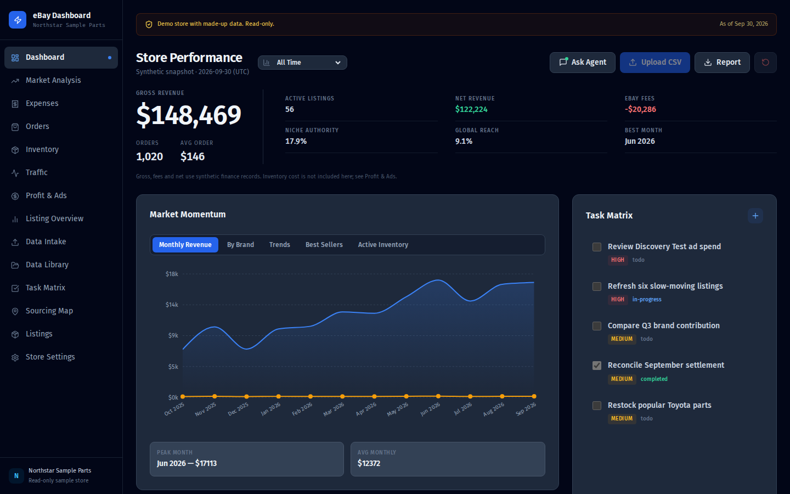
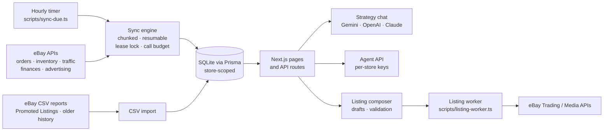
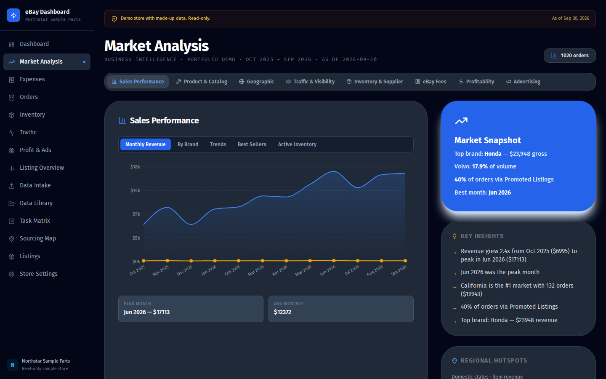
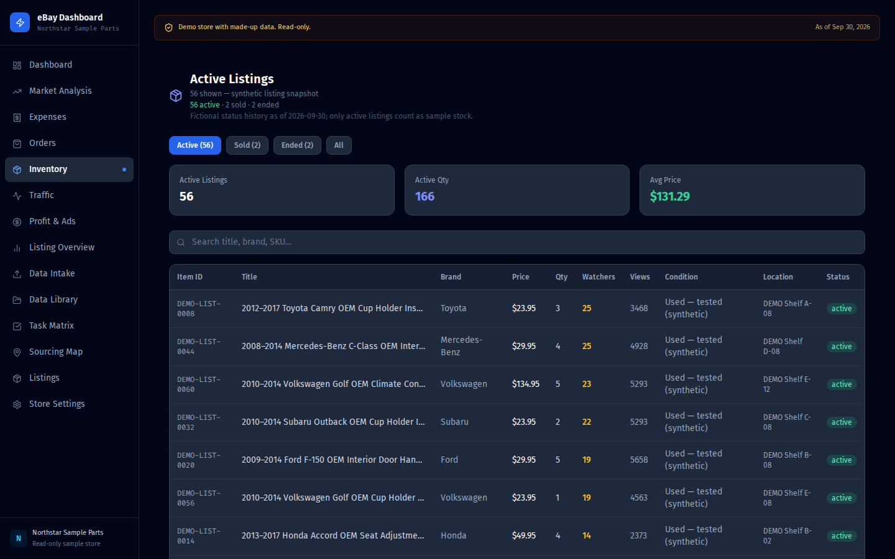
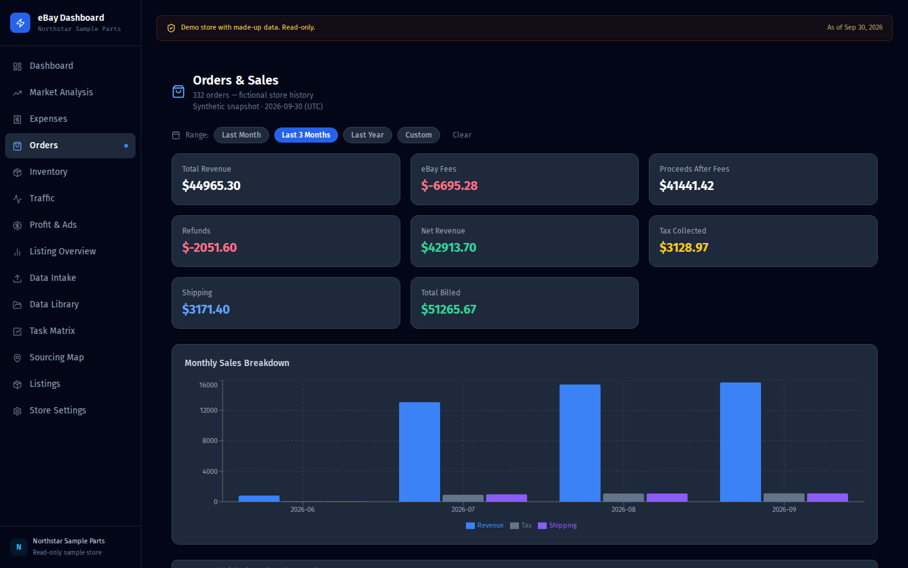
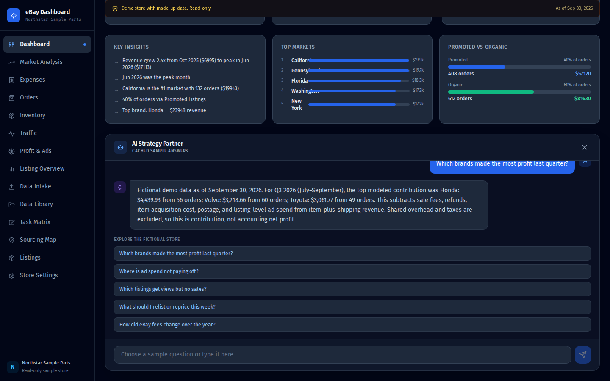
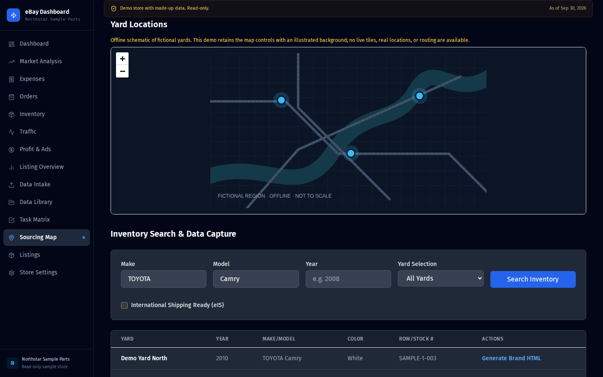
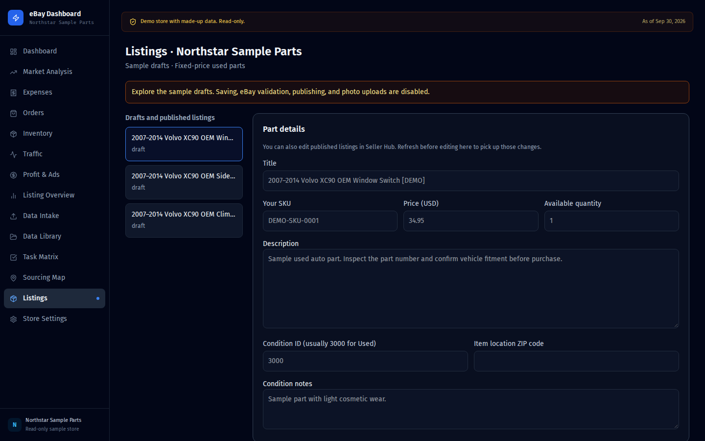

# eBay Seller Ops Dashboard

A business-intelligence and operations dashboard I built and run for my used-auto-parts eBay store. It syncs orders, listings, traffic, finances and advertising from the eBay API into one place, imports eBay's CSV reports for what the API can't reach, and creates and revises listings through a guarded publishing workflow. This repository runs the same application on **Northstar Sample Parts**, a fictional store with a year of made-up data, so it can be explored without an eBay account.

**[Watch the walkthroughs](https://portfolio.kunans.us/projects/ebay-seller-ops-dashboard/#walkthroughs)** · **[Run the demo locally](#run-the-demo-locally)** · **[Portfolio write-up](https://portfolio.kunans.us/projects/ebay-seller-ops-dashboard/)**



*Dashboard overview. Every figure on this page and in the screenshots below comes from the synthetic demo store.*

## What I owned

Built with AI coding agents. I owned the scope, the architecture decisions, testing, deployment and operations: I decide what gets built, review and test every change, and run the dashboard for my own store.

## How it works



An hourly timer decides which of five sync domains are due and runs them through a reporting client that refuses any mutating request before it is sent. Everything lands in one SQLite database, partitioned by store. Pages, the chat assistant and a key-authenticated API for external agents all read that database. Creating and revising listings is a separate path: drafts are validated with eBay, queued, and published by a worker. Each step re-checks the user's role, the store's write switch and the connected seller.

In demo mode, the timer, eBay, the AI providers and every write path are switched off. Chat answers come from a cache built from the demo database.

## Hard problems

- **A 100-call daily allowance.** eBay allows 100 traffic-report calls a day. Per-listing history costs one call per day of history, so two years of it takes about 730 calls and more than a week of scheduled runs. The scheduler asks eBay how much allowance is left rather than counting locally, and a spent allowance counts as waiting, not as a failed sync. ([`traffic-budget.ts`](src/lib/ebay/sync/traffic-budget.ts), [`run-traffic.ts`](src/lib/ebay/sync/run-traffic.ts))
- **Resuming long jobs without losing data.** Long syncs are split into date chunks. A chunk is marked done only after its writes commit, and a failed chunk is retried next time up to a limit. A run that is out of budget stops before the next chunk instead of burning its retries. ([`checkpoints.ts`](src/lib/ebay/sync/checkpoints.ts))
- **Limits that paging can't get around.** The per-listing traffic report returns at most 200 rows and ignores `limit` and `offset`, so it is requested one day at a time. ([`traffic.ts`](src/lib/ebay/sync/traffic.ts))
- **Totals that are silently wrong.** eBay's payout summary can truncate the amount over wide date ranges while still reporting the right payout count, so reconciliation asks for one calendar month at a time and adds them up. A traffic query covering both eBay US and eBay Motors silently sums the two, so each marketplace is requested separately. ([`payout-reconciliation.ts`](src/lib/ebay/sync/payout-reconciliation.ts), [`traffic.ts`](src/lib/ebay/sync/traffic.ts))
- **Data that changes after it is published.** eBay revises the last few days of traffic, so the daily run adds a day and corrects the ones before it. Orders are fetched by last-modified date, so a refund on an old order still arrives. A requested range beyond eBay's 90-day window is clamped and reported, not silently shortened. ([`schedule.ts`](src/lib/ebay/sync/schedule.ts), [`orders.ts`](src/lib/ebay/sync/orders.ts))
- **Proving nothing went missing.** The finance endpoints report eBay's own record count. Collecting fewer records than that after following every page is treated as a fetch error, not a quiet period. ([`finance.ts`](src/lib/ebay/sync/finance.ts))
- **Writes whose outcome is unknown.** A publish that times out may or may not have created a listing, and eBay's Trading API has no idempotency key. An uncertain operation is never replayed automatically. It is reconciled by SKU plus the request's own identifier, and an unrelated listing with the same SKU is not taken as proof of success. Revisions send only changed fields and refuse to overwrite a listing edited in Seller Hub since the last refresh. ([`listing/service.ts`](src/lib/ebay/listing/service.ts))
- **Store isolation by construction.** Business data goes through a store-scoped Prisma client that rejects any query made outside an authorized store context. Raw SQL and unknown models are refused, and nested relation writes must go through explicit services. A route can't leak another store's rows by forgetting a filter. ([`scoped-client.ts`](src/lib/stores/scoped-client.ts), [`route.ts`](src/lib/stores/route.ts))

## By the numbers

Counted from this repository on 26 November 2026.

| API route files | Pages | Test files | Tests | Database migrations | Sync domains |
| --- | --- | --- | --- | --- | --- |
| 50 | 16 | 107 | 1,415 | 26 | 5 |

## Screenshots



*Market Analysis: sales performance, market snapshot and regional hotspots in one workspace.*



*Inventory: a searchable catalog of fictional listings with stock and engagement measures.*



*Orders: date and text filters narrow the sample orders.*



*Chat: a prepared answer computed from the demo database, labelled as cached sample content because live AI is off in the demo.*



*Sourcing: a local sample search over fictional yard inventory, with offline map artwork and no live map tiles.*



*Listings: the composer on a sample draft. Validation and publishing are disabled in the demo.*

## Run the demo locally

**Northstar Sample Parts is fictional.** The demo contains a deterministic year of made-up orders, inventory, traffic, expenses, refunds, advertising, payouts and listing drafts, frozen at **30 September 2026**. You can browse without logging in. All changes and live integrations are disabled.

```sh
npm ci
npx prisma generate
npm run seed:demo
npm run demo:build
npm run demo:start
```

Open [localhost:3941](http://localhost:3941). Use Node.js 24 and a fresh checkout, with no secrets or `.env` file. The demo scripts pin the database to `prisma/demo.db` and refuse any other path. They also refuse to run as root.

- [Setup, deployment and safety boundaries](docs/demo-setup.md)
- [Data provenance and accounting](docs/demo-data.md)
- [Route and safety audit](docs/demo-audit.md)

## Features

### eBay API sync
- **OAuth connection per store**, refreshed automatically. Refresh tokens are encrypted at rest (AES-256-GCM, rotatable keys) and never written to a file.
- **Five sync domains**, each its own module: **orders**, **inventory** (active listings), **traffic** (impressions, views and CTR, store-wide and per listing), **finances and payouts** (reconciled transaction ledger), and **advertising** (Promoted Listings campaign roster).
- **Chunked, resumable and deduplicated.** A lease-based lock stops two syncs overlapping, and per-run logs make failures visible instead of silent. A long-running domain picks up where it left off across many scheduled ticks.
- **Self-scheduling.** An hourly tick decides what is due per domain (`manual`, `daily` or `weekly`, configurable from Settings). It respects eBay's daily call budget and treats a spent budget as a skip, not a failure.
- **CSV fallback, not CSV-or-nothing.** Uploaded reports fill gaps the API can't cover, such as Promoted Listings performance and older history, with no double-counting.

### Stores, users and roles
- **Several stores in one dashboard.** Each store has its own seller connection, data, sync schedule and agent keys, and each tab carries its store in the URL.
- **Four roles per store** (viewer, editor, publisher, administrator) with invitation links, password resets, disabled accounts and immediate session revocation.

### Listing creation
- **Fixed-price listing composer** with category search, required item specifics, vehicle compatibility, photos and the seller's shipping, payment and return policies.
- **Validate before publishing.** eBay's own verification returns warnings and estimated fees. Publishing needs the publisher role, an enabled store write switch, a verified seller and a server-level flag.
- **Seller Hub stays editable.** Refresh imports Seller Hub changes, and revisions send only changed fields.

### Dashboard and analytics
- **Market Analysis** is a multi-tab breakdown covering sales performance, catalog mix, geography, traffic and visibility, inventory and supplier spend, fees, profitability and advertising (ROAS/ACOS, CPS vs CPC spend, campaign roster).
- **Profit and Ads** shows reconciled gross revenue, eBay fees by category, refunds and net, cross-referenced against Promoted Listings attribution.
- **Price comparison** shows how listings are priced across the synced inventory.
- **Task Matrix** holds action items with manual CRUD, AI suggestions, and markdown reports attached by agents.

### AI and sourcing
- **Strategy chat** with Gemini, OpenAI or Claude, selectable in the chat drawer. Keys stay on the server, and upstream error bodies are never forwarded.
- **Live salvage-yard search** detects intent in the conversation, searches public yard inventory by make and model, and injects the results.
- **Sourcing Map** is a standalone make/model search with a map of matching yard inventory.
- **Agent API** (`/api/agent/*`): per-store, key-authenticated read access, plus optional task editing, for an external AI agent.

## Tech stack

| Layer | Technology |
|---|---|
| Framework | Next.js 16 (App Router) |
| Language | TypeScript |
| Styling | Tailwind CSS |
| Database | SQLite via Prisma ORM |
| AI | Google Gemini, OpenAI and Anthropic APIs |
| eBay | Sell (Fulfillment, Inventory, Analytics, Marketing, Finances), Trading and Media APIs |
| Charts | Recharts |
| Maps | Leaflet / React-Leaflet |
| Data fetching | SWR |
| CSV / XLSX / PDF parsing | Papa Parse, ExcelJS, pdf-parse |
| Testing | Vitest |

## Ordinary authenticated mode

The full application runs with `DEMO_MODE` unset. This section describes that mode; you don't need it to run the demo.

You need Node.js 24. The command-line scripts use its built-in type stripping. Integrations are optional: an AI provider key for chat, and an [eBay Developer](https://developer.ebay.com/) application for live sync and listing creation. Without them the dashboard runs on CSV import alone.

```bash
npm ci
cp .env.example .env.local                      # then fill in what you need
npm run auth:hash                               # writes the password hash and session secret to .env.local
DATABASE_URL="file:./dev.db" npx prisma migrate dev
npm run auth:bootstrap                          # creates the owner account
npm run dev                                     # http://localhost:3940
```

Prisma CLI does not load `.env.local`, which is why `DATABASE_URL` is passed explicitly above. Relative SQLite paths resolve from `prisma/`. See `.env.example` for every setting. Example systemd units for the web app, the sync timer and the listing worker are in `deploy/` and at the repository root. Listing writes stay disabled until `EBAY_LISTING_WRITES_ENABLED` and a store's own write switch are both on.

## Project structure

```
src/
├── app/
│   ├── api/
│   │   ├── agent/         # Key-authenticated read API for external agents
│   │   ├── auth/          # Session, logout, invitations (login is in src/pages/api)
│   │   ├── chat/          # AI strategy chat
│   │   ├── ebay/          # OAuth, connection status, sync triggers and settings
│   │   ├── listings/      # Drafts, photos, category metadata, publishing
│   │   ├── stores/        # Stores, membership, agent keys
│   │   ├── users/         # User administration
│   │   └── ...            # metrics, orders, inventory, traffic, profitability, tasks, uploads
│   ├── market/            # Market Analysis (multi-tab)
│   ├── listings/          # Listing composer
│   ├── settings/          # Sync health, connection, schedule, store access
│   └── ...                # overview, orders, inventory, traffic, sourcing, tasks
├── lib/
│   ├── ebay/
│   │   ├── sync/          # One module per domain, plus scheduling, locking, chunking
│   │   ├── listing/       # Composer model, Trading/Media clients, write authorization
│   │   ├── client.ts      # Read-only reporting client
│   │   └── read-only.ts   # Scope list and mutating-request guard
│   ├── stores/            # Store context, authorization, store-scoped Prisma client
│   ├── auth/              # Passwords, sessions, rate limiting, login
│   ├── ai/                # Chat providers
│   ├── demo/              # Read-only demo mode: data, guards, cached answers
│   └── prisma.ts
scripts/                   # Sync scheduler, listing worker, demo seed, auth tools
prisma/                    # Schema and migration history
```

## Security notes

- **Reporting syncs are read-only by construction.** Only read scopes are requested for them, and the reporting HTTP client rejects any mutating request before it leaves the process: a second, independent guard, not just an OAuth-scope promise.
- **Listing writes are a separate path,** used only by explicit listing actions. Every publish or revision re-checks the user's publisher role, the store's write switch, a verified seller binding and a server-level flag. Agent keys can never publish.
- **Ordinary mode requires a signed-in user** on every page and API route, and fails closed when its authentication secrets are missing. Login is rate-limited per client, and sessions are server-side and revocable.
- **Demo mode** is enabled only by the server environment `DEMO_MODE=1`, never by a cookie, query parameter or client flag. It allows only audited synthetic reads and cached chat. The proxy, route authorization, both database clients, every live integration client and every background script each refuse writes independently. See the [route audit](docs/demo-audit.md).
- **Nothing sensitive is tracked.** All `.env*` files except the empty `.env.example` are ignored, as are databases and export files. Enable the local secret guard after cloning with `git config core.hooksPath scripts/git-hooks`; its regression tests are in `scripts/git-hooks/pre-commit.test.sh`.

## History

Version 1 was [an ERPNext connector](https://github.com/reviaro/ebay-integration) that synced eBay orders and inventory into ERPNext. Once the eBay API moved into this dashboard, the connector was retired.

## License

[MIT](LICENSE). The demo data is entirely fictional and contains no real customer records.
